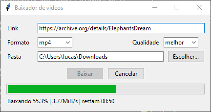

# Baixador de vídeos

[](https://github.com/LucasMks7/baixador-videos/actions/workflows/testes.yml)

Ferramenta minimalista para baixar um vídeo em MP4 ou extrair o áudio em MP3 ou WAV, pela linha de comando ou por uma janela simples.



O vídeo da captura é o [Elephants Dream](https://archive.org/details/ElephantsDream), da Blender Foundation, distribuído com licença Creative Commons.

> **Uso responsável:** este projeto é para uso pessoal, apenas com conteúdo próprio ou autorizado. Veja a seção [Uso responsável](#uso-responsável).

## Instalação

O projeto não reimplementa o download: ele usa o [yt-dlp](https://github.com/yt-dlp/yt-dlp) e o [ffmpeg](https://ffmpeg.org/), que precisam estar instalados e disponíveis no PATH, junto com o ffprobe que acompanha o ffmpeg. No Windows:

```text
winget install yt-dlp.yt-dlp
winget install yt-dlp.FFmpeg
```

Depois, com Python 3.10 ou superior:

```text
pip install git+https://github.com/LucasMks7/baixador-videos
```

A instalação cria dois comandos: `baixar`, para o terminal, e `baixar-janela`, que abre a janela. O projeto em si não tem dependências além da biblioteca padrão do Python.

## Linha de comando

```text
baixar <link>                                # vídeo em MP4, na melhor qualidade
baixar <link> --qualidade 720                # vídeo em MP4, até 720p
baixar <link> --formato mp3                  # apenas o áudio, em MP3
baixar <link> --formato wav                  # apenas o áudio, em WAV
baixar <link> --formato mp3 --pasta "C:\Musicas"
```

Um exemplo, com o trailer do Big Buck Bunny, também da Blender Foundation e com licença Creative Commons:

```text
> baixar https://download.blender.org/peach/trailer/trailer_480p.mov --formato mp3 --pasta C:\Musicas
Preparando o download...
Download concluído.
Arquivo salvo em: C:\Musicas\trailer_480p [trailer_480p].mp3
```

| Opção | Valores | Padrão |
| --- | --- | --- |
| `--formato` | `mp4`, `mp3`, `wav` | `mp4` |
| `--qualidade` | `melhor`, `1080`, `720`, `480`, `360` (apenas em MP4) | `melhor` |
| `--pasta` | qualquer caminho; a pasta é criada se não existir | a pasta atual |

`--qualidade` é um limite: o comando baixa a maior resolução até o valor pedido. Se o vídeo só existir em resoluções maiores, baixa a menor delas.

No PowerShell, um caminho com espaços não pode terminar em `\`: use `"C:\Minhas Musicas"`, e não `"C:\Minhas Musicas\"`.

O comando baixa um único item. Se o link for de uma playlist, apenas o primeiro é baixado.

Durante o download, o terminal mostra a porcentagem, a velocidade e o tempo restante. Um vídeo em que imagem e som são baixados separadamente mostra a porcentagem duas vezes, uma para cada parte. `Ctrl+C` cancela o download e deixa o arquivo parcial (`.part`) na pasta de destino.

| Código de saída | Significado |
| --- | --- |
| `0` | Download concluído |
| `1` | O download falhou (rede, vídeo indisponível, acesso negado etc.) |
| `2` | Entrada inválida (link, pasta ou opções) |
| `130` | Cancelado com `Ctrl+C` |

## Janela

```text
baixar-janela
```

Abre uma janela com os mesmos campos da linha de comando: link, formato, qualidade e pasta de destino, que começa na pasta Downloads. A janela usa o mesmo código de download do comando `baixar` e continua respondendo enquanto o download acontece.

Uma barra mostra o andamento, com a velocidade e o tempo restante. O botão **Cancelar** interrompe o download, e fechar a janela faz o mesmo. Como no `Ctrl+C`, o arquivo parcial (`.part`) fica na pasta de destino.

## Se algo der errado

Os erros mais comuns do yt-dlp são traduzidos para mensagens em português, tanto no terminal quanto na janela. Dois casos merecem atenção:

- **"O site recusou o download (erro 403)"** ou um vídeo público que aparece como indisponível: os sites mudam com frequência, e o yt-dlp precisa acompanhar. Atualize-o com `winget upgrade yt-dlp.yt-dlp` e tente de novo.
- **"O acesso a este vídeo foi negado"**: o vídeo é privado, exige login ou tem restrição de região. O programa não contorna esses bloqueios, nem proteção por DRM.

## Como funciona

| Módulo | Responsabilidade |
| --- | --- |
| `validacao.py` | Confere o link e prepara a pasta de destino, sem acessar a rede |
| `download.py` | Monta o comando do yt-dlp, lê o progresso da saída dele e permite cancelar |
| `erros.py` | Traduz os erros do yt-dlp em mensagens claras |
| `cli.py` | Linha de comando |
| `janela.py` | Janela em Tkinter |

A linha de comando e a janela são duas cascas finas sobre o mesmo núcleo: as duas chamam a mesma função `baixar()` e recebem o progresso por uma função de retorno, então o núcleo não sabe qual interface está em uso.

Na janela, o download roda em uma thread separada, para a tela não travar. Como o Tkinter só pode ser usado pela thread que o criou, a thread de trabalho deixa o progresso em uma fila, que a janela lê a cada 100 ms. Para cancelar, o programa encerra o yt-dlp junto com os processos que ele abriu, como o ffmpeg.

Os testes simulam o yt-dlp, então não usam a rede. Eles rodam no GitHub Actions em Windows e Ubuntu, na versão mínima e na mais recente do Python. No Ubuntu do CI não há tela, então os testes que abrem a janela de verdade são pulados lá e rodam no Windows.

## Desenvolvimento

```bash
git clone https://github.com/LucasMks7/baixador-videos
cd baixador-videos
python -m venv .venv
source .venv/Scripts/activate   # Windows com Git Bash
# .venv\Scripts\Activate.ps1    # Windows com PowerShell
pip install -e ".[dev]"
pytest
```

Se o projeto estiver em uma pasta sincronizada, como o OneDrive, crie o ambiente virtual fora dela para evitar sincronização pesada.

## Limitações

- Baixa um item por vez; playlists inteiras estão fora do escopo.
- Depende do yt-dlp e do ffmpeg instalados à parte.
- No Linux e no macOS, cancelar encerra o yt-dlp, mas não os processos que ele abriu. No Windows, encerra todos.

## Uso responsável

Este projeto é para uso pessoal, apenas com conteúdo próprio ou autorizado. Ele não contorna DRM, paywalls nem bloqueios de acesso. Os Termos de Serviço do YouTube restringem downloads, e cada pessoa é responsável por respeitá-los e por respeitar os direitos autorais.

## Licença

[MIT](LICENSE)
